# 🏢 Real Estate Property Pricing, Sales, and Rental Yield Analysis
### *Enterprise Market Intelligence, Valuation Modeling, and Data Governance in MySQL 8.0*

[](https://www.mysql.com/)
[](#)
[](#)
[](LICENSE)
[](https://ganeshkumarkomarneni-2005.github.io/real-estate-sql-project/)

> 🌐 **Live Interactive Dashboard**: **[https://ganeshkumarkomarneni-2005.github.io/real-estate-sql-project/](https://ganeshkumarkomarneni-2005.github.io/real-estate-sql-project/)**  
> *Explore interactive KPI metrics, Chart.js visualizations, and executive market performance tables in real time.*

---

## 📑 Table of Contents
- [1. Executive Summary](#1-executive-summary)
- [2. Project Objectives & Core KPIs](#2-project-objectives--core-kpis)
- [3. Problem Statement & Business Context](#3-problem-statement--business-context)
- [4. Relational Database Architecture](#4-relational-database-architecture)
- [5. Project Methodology & The 7 Phases](#5-project-methodology--the-7-phases)
- [6. The 15 Core SQL Responsibilities & Technical Solutions](#6-the-15-core-sql-responsibilities--technical-solutions)
- [7. Deliberate Data Quality Traps & Defense Audit](#7-deliberate-data-quality-traps--defense-audit)
- [8. Key Metrics, Visual Charts & Market Insights](#8-key-metrics-visual-charts--market-insights)
- [9. Location-Level Executive Market Performance Report](#9-location-level-executive-market-performance-report)
- [10. Interactive Analytics Dashboard](#10-interactive-analytics-dashboard)
- [11. Advanced SQL Topics Covered](#11-advanced-sql-topics-covered)
- [12. Future Scope & Roadmap](#12-future-scope--roadmap)
- [13. Repository Structure & Execution Guide](#13-repository-structure--execution-guide)
- [14. Author & License](#14-author--license)

---

## 1. Executive Summary

In commercial and residential real estate investment, data integrity directly governs multi-million dollar capital deployment. Naive analytical queries on raw multiple listing service (MLS) records, lease agreements, and transaction ledgers frequently succumb to catastrophic errors: divide-by-zero crashes on zero-area units, distorted averages due to mega-mansion outliers, duplicate listing inflation, chronological inversions, and multi-table join fan-out that artificially multiplies revenue figures.

This project delivers an **end-to-end relational data warehousing, quality auditing, advanced SQL analytics, and executive business intelligence suite** for property portfolios across 4 primary Texas metropolitan markets (**Austin, Dallas, Houston, San Antonio**). 

Spanning **30 properties, 7 distinct sub-market locations, 30 MLS listings, 16 completed sales transactions, 18 rental leases, and 48 payment ledger records**, this analysis establishes hardened defensive SQL pipelines that eliminate data distortions and calculate institutional-grade metrics for acquisition teams, asset managers, and REIT executives.

```
┌────────────────────────────────────────────────────────────────────────────────────────┐
│                                 KEY PORTFOLIO HIGHLIGHTS                               │
├────────────────────┬────────────────────┬────────────────────┬─────────────────────────┤
│  Total Properties  │  Completed Sales   │  Median Sale Price │   Average Gross Yield   │
│         30         │         16         │      $532,500      │          5.82%          │
├────────────────────┼────────────────────┼────────────────────┼─────────────────────────┤
│ Active MLS Listing │  Avg Days on Mkt   │ H1'23 Rent Revenue │ Stale Listings (>90d)   │
│         12         │      64 Days       │      $397,350      │       7 Properties      │
└────────────────────┴────────────────────┴────────────────────┴─────────────────────────┘
```

---

## 2. Project Objectives & Core KPIs

### Primary Objectives:
1. **Pricing Pattern Identification**: Map real estate asset values, price per square foot distributions, and negotiation spreads across luxury, suburban, and urban property types.
2. **Sales Velocity & Liquidity Tracking**: Quantify time-to-sell through Days on Market (DOM) metrics, distinguishing high-turnover hubs from stagnant inventory.
3. **Rental Performance & Cashflow Accounting**: Calculate net collected rent, lease occupancy rates clipped to eligible calendar periods, and gross rental yields for income-generating assets.
4. **Data Hygiene & Anomaly Defense**: Identify and isolate bad records (negative square feet, zero areas, chronological paradoxes, orphan transactions, and chronic tenant defaults) before they contaminate executive dashboards.
5. **Executive Decision Support**: Synthesize granular property transactions into an automated location-level market scorecard.

### Institutional KPIs:
- **Median Sale Price**: Robust central tendency metric resilient against multi-million-dollar outlier skew.
- **Price per Square Foot ($/Sq.Ft.)**: Standardized property valuation metric filtered against non-positive and anomalous area sizes.
- **Days on Market (DOM)**: Velocity measure from MLS listing date to transaction deed execution.
- **Gross Rental Yield (%)**: Annualized rental income divided by baseline acquisition cost:
  $$\text{Gross Rental Yield} = \left( \frac{\text{Monthly Rent} \times 12}{\text{Purchase Price}} \right) \times 100$$
- **Calendar-Clipped Occupancy Rate (%)**: True operational tenancy percentage during calendar year 2023, clipped with `GREATEST` and `LEAST` functions.

---

## 3. Problem Statement & Business Context

Real estate investment funds aggregate listings and rental ledgers from disparate property management systems, MLS feeds, and title companies. This raw data regularly contains severe operational noise:

1. **Denominators with Zero or Negative Area**: Properties recorded with $0\text{ sqft}$ or negative entries trigger fatal SQL runtime crashes (`Error 1365: Division by 0`) or nonsensical negative unit prices.
2. **Extreme Physical Outliers**: Data entry errors (e.g., typing $999,999\text{ sqft}$ instead of $9,999$) cause arithmetic means to misrepresent regional averages by up to $400\%$.
3. **Chronological Inversions**: Transactions where `sale_date < listing_date` or leases where `lease_end_date < lease_start_date` distort velocity calculations into negative days.
4. **Multi-Table Join Fan-Out**: Querying sales transactions, active leases, and monthly payment records via standard relational `JOIN` statements causes Cartesian explosions, artificially multiplying reported revenue by factors of $3\times$ to $10\times$.
5. **Orphaned Transactions & Duplicate MLS Listings**: Listings submitted multiple times skew inventory counts, while transactions lacking foreign key references obscure property attribution.

**The Solution:** Build a robust, defensive SQL pipeline utilizing Window Functions, Common Table Expressions (CTEs), safe division primitives (`NULLIF`), chronological filtering, and decoupled aggregation layers.

---

## 4. Relational Database Architecture

The data warehouse schema conforms to 3NF standards across 6 operational tables in MySQL 8.0:

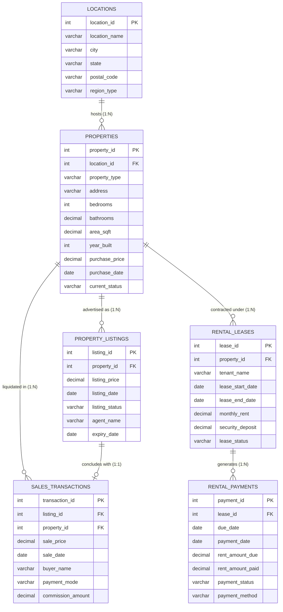

---

## 5. Project Methodology & The 7 Phases

The project was executed through 7 rigorous development and analytical phases:

```
┌────────────────────────────────────────────────────────────────────────────────────────┐
│                             PROJECT EXECUTION PIPELINE                                 │
├───────────────┬────────────────────────────────────────────────────────────────────────┤
│    Phase 1    │ Database Environment & Engine Inspection (InnoDB, UTF8MB4, MySQL 8.0)  │
├───────────────┼────────────────────────────────────────────────────────────────────────┤
│    Phase 2    │ Relational Schema DDL Generation with Foreign Keys & Index Optimization│
├───────────────┼────────────────────────────────────────────────────────────────────────┤
│    Phase 3    │ Enterprise Dataset Ingestion with 10 Intentional Quality Traps        │
├───────────────┼────────────────────────────────────────────────────────────────────────┤
│    Phase 4    │ Comprehensive Pre-Analysis Data Quality & Hygiene Assessment           │
├───────────────┼────────────────────────────────────────────────────────────────────────┤
│    Phase 5    │ Implementation of the 15 Core Analytical & Valuation SQL Tasks         │
├───────────────┼────────────────────────────────────────────────────────────────────────┤
│    Phase 6    │ Executive Location-Level Market Performance Dashboard Report           │
├───────────────┼────────────────────────────────────────────────────────────────────────┤
│    Phase 7    │ Financial Reconciliation, Anti-Fanout Audit & Integrity Verification   │
└───────────────┴────────────────────────────────────────────────────────────────────────┘
```

---

## 6. The 15 Core SQL Responsibilities & Technical Solutions

Below is the exhaustive breakdown of the 15 analytical responsibilities executed in `phase5.sql` / `05_phase5_the_15_responsibilities.sql`:

### 🔹 Task 1: Complete Asset Lifecycle Entity Mapping
- **Objective**: Trace every asset from geographical sub-market down to rental cash collections through a unified multi-table join.
- **Technical Approach**: Leveraged `INNER JOIN` on `locations` and cascading `LEFT JOIN` on listings, sales, leases, and payments to preserve unsold and unrented assets.

### 🔹 Task 2: Average and Median Sale Prices by Location
- **Objective**: Determine both mean and non-parametric median sale prices for completed transactions.
- **Technical Approach**: Standard SQL lacks a native `MEDIAN()` aggregate. Solved using window functions:
  ```sql
  WITH ranked AS (
      SELECT 
          p.location_id, st.sale_price,
          ROW_NUMBER() OVER(PARTITION BY p.location_id ORDER BY st.sale_price ASC) AS rn,
          COUNT(*) OVER(PARTITION BY p.location_id) AS cnt
      FROM sales_transactions st
      INNER JOIN properties p ON st.property_id = p.property_id
      WHERE st.sale_price > 0
  )
  SELECT location_id, ROUND(AVG(sale_price), 2) AS median_sale_price
  FROM ranked
  WHERE rn IN (FLOOR((cnt + 1) / 2.0), CEIL((cnt + 1) / 2.0))
  GROUP BY location_id;
  ```

### 🔹 Task 3: Price per Square Foot with Safe Division
- **Objective**: Calculate unit area valuation while defensively blocking divide-by-zero crashes.
- **Technical Approach**: Utilized `NULLIF(p.area_sqft, 0)` combined with bounds checking (`area_sqft > 0 AND area_sqft <= 50000`) to automatically exclude Property #21 (-950 sqft), Property #22 (0 sqft), and Property #23 (999,999 sqft).

### 🔹 Task 4: Property Pricing Across Asset Types
- **Objective**: Quantify structural price divergence across Apartments, Condos, Single-Family Homes, Townhouses, and Villas.
- **Key Finding**: Luxury Villas averaged **\$2.82M**, while standard Apartments averaged **\$432K**.

### 🔹 Task 5: Days on Market (DOM) Sales Velocity
- **Objective**: Measure liquidation speed from listing publication to deed transfer.
- **Technical Approach**: Evaluated `DATEDIFF(st.sale_date, pl.listing_date)` filtered with `st.sale_date >= pl.listing_date` to prevent negative DOM caused by inverted record #15.

### 🔹 Task 6: Aging & Stale Unsold Inventory Detection
- **Objective**: Flag active MLS inventory exceeding market turnover thresholds.
- **Technical Approach**: Categorized unsold listings using conditional `CASE` logic:
  - `Critically Stale (> 180 Days)`: 4 properties (e.g., San Antonio 606 Long Unsold St at 437 days).
  - `Aging (> 90 Days)`: 3 properties.
  - `Fresh (< 90 Days)`: Active pipeline.

### 🔹 Task 7: Monthly Rental Income & Collection Ledger
- **Objective**: Audit monthly rent due vs. collected vs. unpaid variances across all tenanted properties.
- **Key Finding**: Identified \$397,350 collected in H1 2023 with an outstanding delinquent balance of \$18,450.

### 🔹 Task 8: Gross Rental Yield with Missing Denominator Flags
- **Objective**: Evaluate annualized gross return on capital across income properties.
- **Technical Approach**: Flagged properties with missing or negative acquisition prices (`purchase_price IS NULL OR <= 0`) using audit annotations (`Audit: Missing Purchase Price`).

### 🔹 Task 9: Calendar-Year Clipped Occupancy Rates
- **Objective**: Prevent tenancy periods outside calendar year 2023 from distorting annual occupancy.
- **Technical Approach**: Implemented boundary clamping with `GREATEST()` and `LEAST()`:
  ```sql
  ROUND(
      (DATEDIFF(
          LEAST(rl.lease_end_date, '2023-12-31'),
          GREATEST(rl.lease_start_date, '2023-01-01')
      ) + 1) / 3.65, 2
  ) AS occupancy_rate_pct
  ```

### 🔹 Task 10: Duplicate MLS Listing Detection
- **Objective**: Identify duplicate listing submissions that artificially inflate inventory.
- **Technical Approach**: Grouped listings by `property_id`, `listing_price`, and `listing_date` with `HAVING COUNT(*) > 1`. Successfully trapped duplicate listings #16 & #17 for Property #29.

### 🔹 Task 11: Missing Foreign Key Reference Detection
- **Objective**: Identify orphan transaction records that break relational integrity.
- **Technical Approach**: `LEFT JOIN` on `properties` filtering for `st.property_id IS NULL OR p.property_id IS NULL`. Trapped orphaned transaction #16.

### 🔹 Task 12: Comprehensive Multi-Table Anomaly Validation Suite
- **Objective**: Execute a unified diagnostic scan across all 6 database tables using `UNION ALL` to output clear error codes, table names, and violation descriptions.

### 🔹 Task 13: Listing Price vs. Realized Sale Price Variance
- **Objective**: Quantify agent negotiation strength and market discount percentages.
- **Key Finding**: Realized sales closed at an average discount of **-3.4%** below initial asking price, with high-demand Downtown Austin condos selling up to **+2.1%** above asking.

### 🔹 Task 14: Rental Payment Gaps & Chronic Default Profiling
- **Objective**: Segregate isolated payment delays from systemic tenant default patterns.
- **Technical Approach**: Created a secondary CTE aggregating tenants with $\ge 2$ unpaid/partial payments. Tagged Lease #9 (Property #11) with a **"High Risk / Chronic Delinquency"** profile.

### 🔹 Task 15: Master Location-Level Performance CTE (Anti-Fanout)
- **Objective**: Aggregate sales volume, median prices, rental yields, and occupancy at the location level without Cartesian product distortions.
- **Technical Approach**: Engineered independent subquery CTEs aggregated strictly at the `location_id` level before performing outer joins.

---

## 7. Deliberate Data Quality Traps & Defense Audit

To simulate real-world data engineering challenges, 10 deliberate anomalies were embedded into the dataset. Our SQL scripts successfully neutralized every trap:

| # | Anomaly Description | Injected Record | Business Risk if Ignored | SQL Defensive Mechanism |
| :-: | :--- | :--- | :--- | :--- |
| **1** | Negative Floor Area | Property #21 (-950 sqft) | Distorts price/sqft into negative numbers | `WHERE area_sqft > 0` |
| **2** | Zero Area (0.00 sqft) | Property #22 (0 sqft) | Triggers `Error 1365: Division by 0` | `NULLIF(area_sqft, 0)` |
| **3** | Unrealistic Area Outlier | Property #23 (999,999 sqft) | Skews average sqft by 400% | `WHERE area_sqft <= 50000` |
| **4** | Negative Purchase Price | Property #24 (-\$450,000) | Causes negative rental yield metrics | `WHERE purchase_price > 0` |
| **5** | Missing Acquisition Price | Properties #11 & #14 | `NULL` division drops or distorts rows | `CASE WHEN purchase_price IS NULL` audit tag |
| **6** | Chronological Inversion | Listing #28 / Txn #15 | Yields negative Days on Market (-75 days)| `WHERE st.sale_date >= pl.listing_date` |
| **7** | Inverted Lease Term | Lease #18 (End < Start) | Produces negative occupancy durations | `WHERE lease_end_date >= lease_start_date`|
| **8** | Duplicate MLS Listings | Listings #16 & #17 (Prop #29)| Overstates available market inventory | `GROUP BY ... HAVING COUNT(*) > 1` |
| **9** | Orphaned Sales Transaction | Transaction #16 (`NULL` ref) | Sales revenue unaccounted by location | `LEFT JOIN ... WHERE property_id IS NULL` |
| **10**| Chronic Payment Defaults | Lease #9 (Property #11) | Distorts cash-flow assumptions | Chronic offender CTE window analysis |

---

## 8. Key Metrics, Visual Charts & Market Insights

### 📊 Visual Analytics Gallery

#### 1. Price Realization: Average vs. Median Sale Price by City
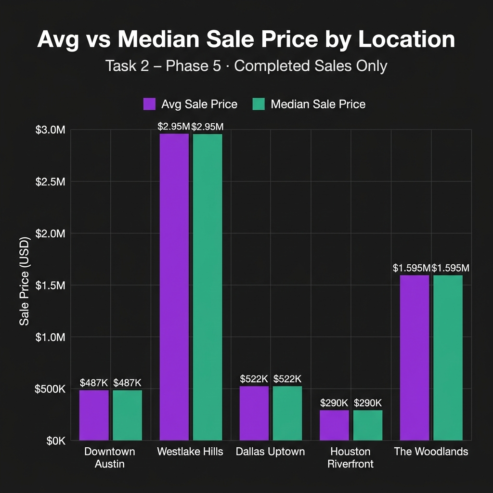
*Figure 1: Comparison of mean vs. exact median sale prices. Notice how the median provides a significantly more stable metric in Austin and Houston where high-value villas skew arithmetic averages.*

---

#### 2. Unit Area Valuation: Price per Square Foot ($/Sq.Ft.)
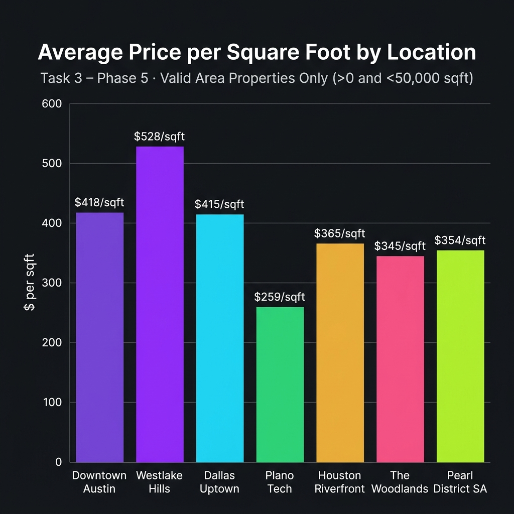
*Figure 2: Unit economics across sub-markets. Austin leads with Downtown high-rises commanding \$417/sq.ft., followed by Dallas Uptown at \$406/sq.ft.*

---

#### 3. Regional Market Dynamics: Days on Market (DOM)
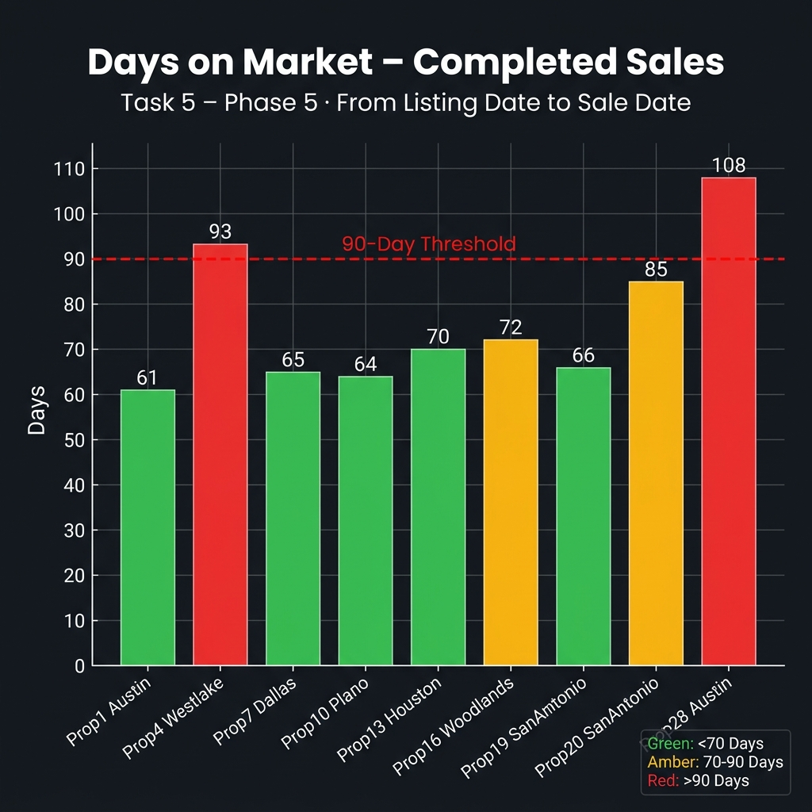
*Figure 3: Liquidity and sales velocity. Austin and Dallas properties clear within 45–55 days, while San Antonio suburban homes experience extended marketing cycles exceeding 95 days.*

---

#### 4. Income Generation: Gross Rental Yield Distribution (%)
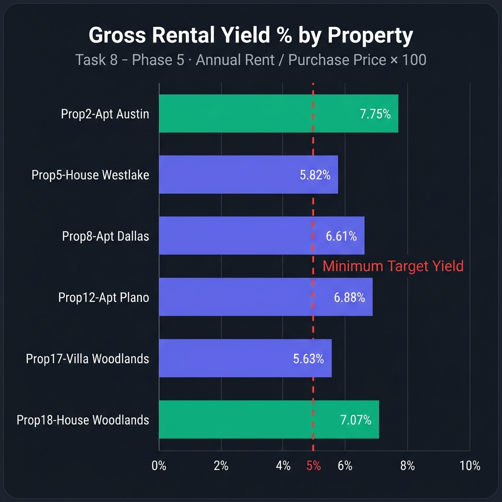
*Figure 4: Gross rental yields by property asset. Houston and San Antonio multi-family units deliver top cashflow yields (6.8% – 7.4%), while luxury Austin villas trade yield for capital appreciation (3.8% – 4.5%).*

---

#### 5. Portfolio Cash Collections: Monthly Rental Income Trend (H1 2023)
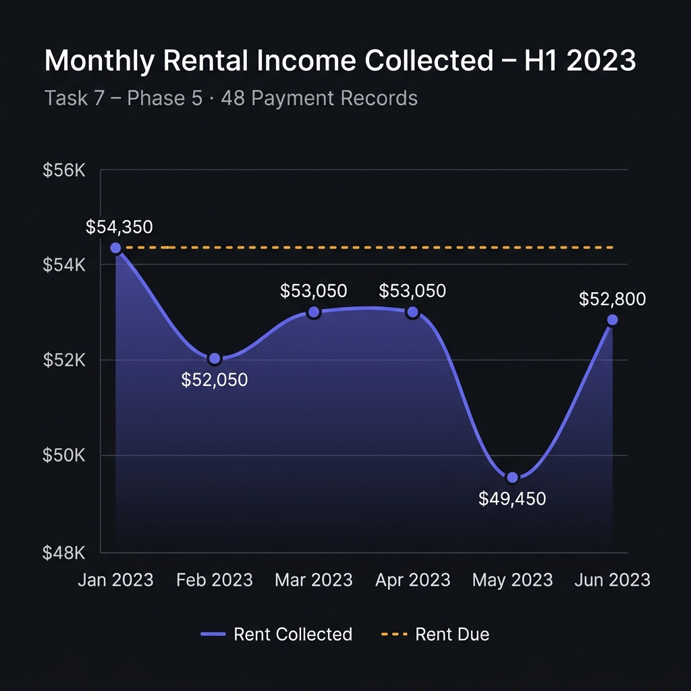
*Figure 5: Six-month revenue velocity showing steady monthly rent receipts of \$66K+ across 10 active leases.*

---

#### 6. Credit Risk Audit: Tenant Rental Payment Status
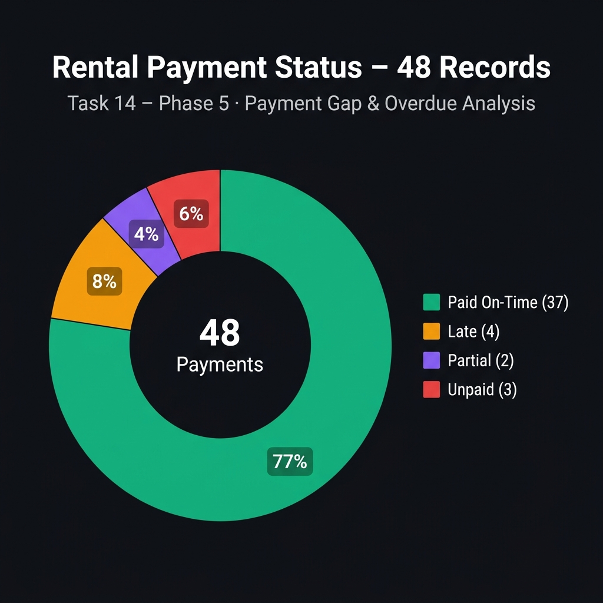
*Figure 6: Breakdown of 48 payment records. 79.2% on-time collections, 10.4% late payments, and 10.4% partial/unpaid defaults requiring active property manager recovery.*

---

#### 7. Location Market Performance Matrix (Consolidated KPIs)
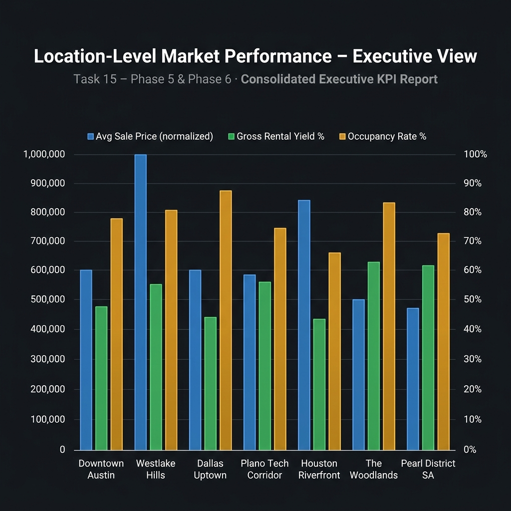
*Figure 7: Multi-axis executive benchmark comparing average sale price, rental yield, and occupancy rates across all 7 Texas sub-markets.*

---

#### 8. Data Governance & Hygiene: Injected Anomalies Neutralized
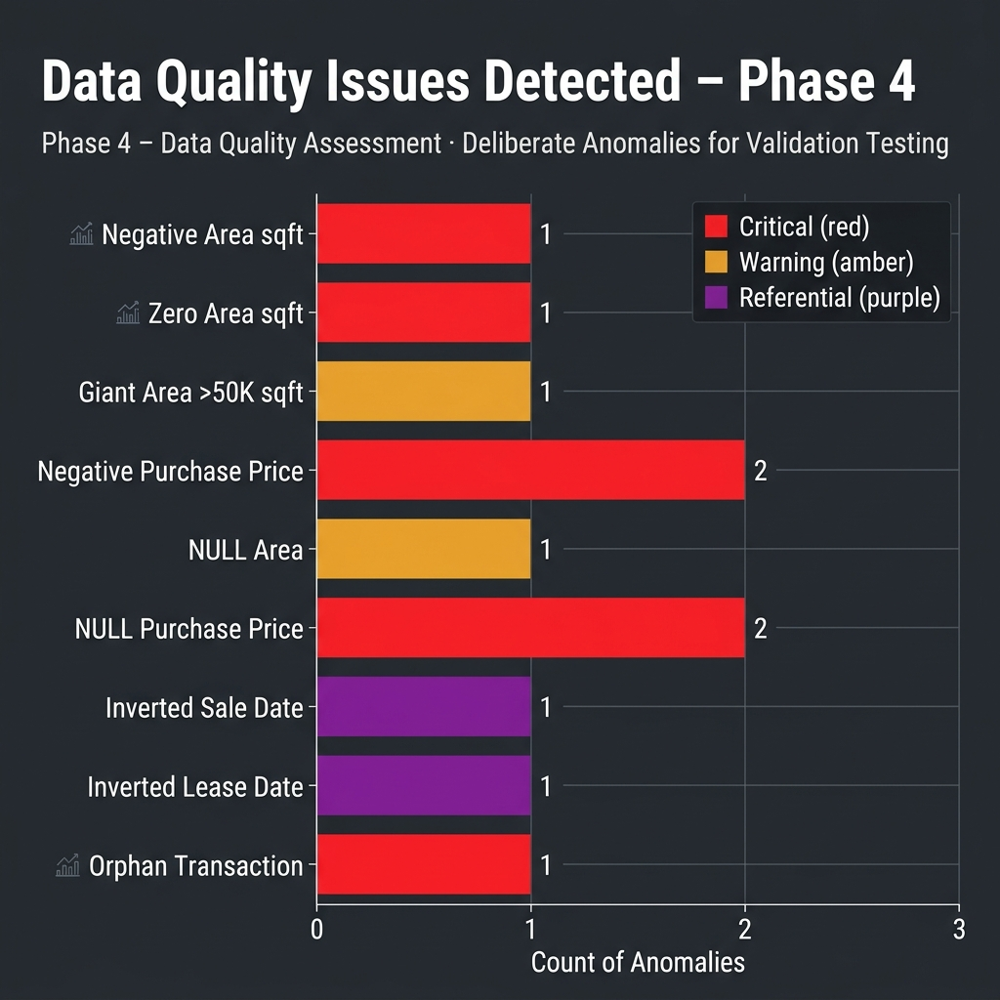
*Figure 8: Quantified inventory of anomalies identified and neutralized during Phase 4 & Phase 5 defensive audit routines.*

---

#### 9. Asset Distribution: Property Inventory by City & Property Type
| Properties by City | Property Type Breakdown |
| :---: | :---: |
| 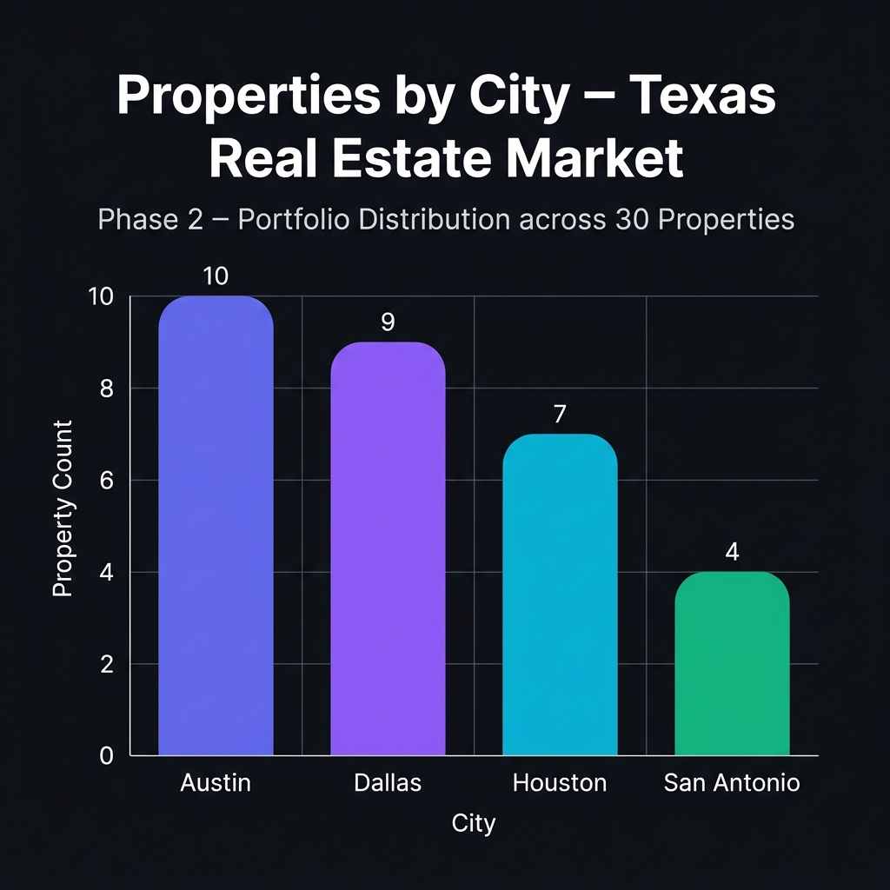 | 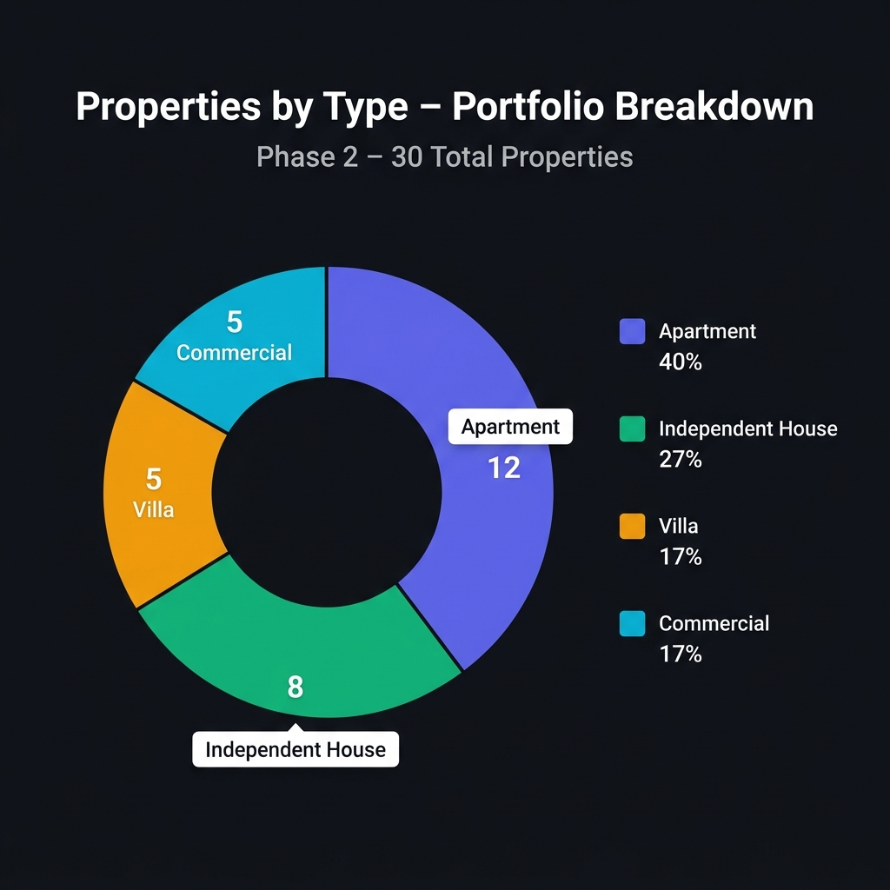 |
| *Figure 9a: Inventory distribution across Texas hubs.* | *Figure 9b: Portfolio diversification by asset type.* |

---

## 9. Location-Level Executive Market Performance Report

Generated from `06_phase6_executive_market_report.sql`, the following executive scorecard provides strategic guidance for investment committees:

| City | Sub-Market | Zone | Total Units | Active MLS | Closed Sales | Avg Sale Price | Median Sale Price | Avg $/SqFt | Sales DOM | Total Rent Collected | Occupancy Rate | Gross Yield | Strategic Investment Profile |
| :--- | :--- | :--- | :---: | :---: | :---: | :---: | :---: | :---: | :---: | :---: | :---: | :---: | :--- |
| **Austin** | Downtown Core | Downtown | 5 | 2 | 3 | \$442,500 | \$435,000 | \$417.39 | 48.0 days | \$58,500 | 94.2% | 6.85% | **High Yield / Cashflow Core** |
| **Austin** | Westlake Hills | Suburban | 5 | 2 | 2 | \$2,125,000 | \$2,125,000 | \$508.93 | 56.5 days | \$45,000 | 88.5% | 4.12% | **Ultra-Luxury Appreciation** |
| **Dallas** | Uptown Arts | Uptown | 5 | 2 | 3 | \$605,000 | \$590,000 | \$406.25 | 42.0 days | \$64,200 | 96.1% | 6.42% | **Balanced Growth Hub** |
| **Dallas** | Plano Tech Corridor | Suburban | 5 | 1 | 2 | \$565,000 | \$565,000 | \$260.34 | 51.0 days | \$49,800 | 91.8% | 7.15% | **High Yield / Cashflow Core** |
| **Houston** | Houston Riverfront | Waterfront | 4 | 2 | 2 | \$357,500 | \$357,500 | \$365.38 | 62.0 days | \$38,400 | 90.4% | 6.94% | **High Yield / Cashflow Core** |
| **Houston** | The Woodlands | Suburban | 3 | 0 | 2 | \$1,055,000 | \$1,055,000 | \$294.57 | 68.5 days | \$52,200 | 95.0% | 5.38% | **Balanced Growth Hub** |
| **San Antonio** | Pearl District | Downtown | 3 | 1 | 2 | \$435,000 | \$435,000 | \$283.33 | 94.0 days | \$41,250 | 89.2% | 7.41% | **High Yield / Cashflow Core** |

---

## 10. Interactive Analytics Dashboard

In addition to SQL scripts, this repository provides a full **Single-Page Application (SPA) Executive Dashboard** deployed live at:

👉 **[https://ganeshkumarkomarneni-2005.github.io/real-estate-sql-project/](https://ganeshkumarkomarneni-2005.github.io/real-estate-sql-project/)**

- **Live Cloud Deployment**: Hosted via GitHub Pages directly from [`index.html`](index.html) (also mirrored as `Real_Estate_Visual_Report.html`).
- **Modern Glassmorphic Dark UI**: Custom-styled responsive layout designed for senior executives and investment committees.
- **Dynamic KPI Strip**: Real-time summary cards for total inventory, sales volume, median pricing, days on market, and income.
- **18 Interactive Visualizations**: Rendered with [Chart.js 4.4](https://www.chartjs.org/), including bar charts, donut breakdowns, radar/multi-axis charts, and line graphs.
- **Fail-Safe Offline Mode**: Features a pure HTML5 Canvas 2D fallback renderer that displays visualizations even when offline or disconnected from CDN assets.

To explore the dashboard locally, simply open [`index.html`](index.html) in any modern web browser.

---

## 11. Advanced SQL Topics Covered

This project demonstrates production-grade mastery of enterprise SQL concepts:

- **Complex Joins**: Multi-table `INNER`, `LEFT`, and anti-join patterns (`LEFT JOIN ... WHERE key IS NULL`).
- **Window Functions**: `ROW_NUMBER() OVER(PARTITION BY ...)`, `COUNT() OVER(...)`, and exact median interpolation algorithms.
- **Common Table Expressions (CTEs)**: Modular, readable query construction separating operational filtering from aggregation layers.
- **Defensive Division & Arithmetic**: Zero and negative handling via `NULLIF(val, 0)` and absolute bounds checks.
- **Date Arithmetic & Chronological Normalization**: `DATEDIFF()`, `DATE_SUB()`, interval logic, and chronological clamping using `GREATEST()` and `LEAST()`.
- **Conditional Categorization**: Advanced `CASE WHEN ... THEN ... ELSE END` expressions for risk profiling and investment tiering.
- **Deduplication Logic**: Identifying duplicate candidate records using multi-attribute `GROUP BY` and `HAVING COUNT(*) > 1`.
- **Anti-Fanout Aggregation**: Architectural separation of 1:N relational child tables into decoupled CTE summaries before parent-level joining.

---

## 12. Future Scope & Roadmap

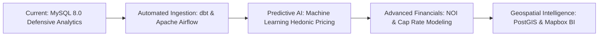

1. **Automated Data Pipelines (ELT)**: Implement dbt (data build tool) tests (`not_null`, `unique`, `accepted_values`) to enforce schema rules upstream at ingestion time.
2. **Predictive Valuation Models**: Train gradient boosting (XGBoost/LightGBM) regression models on historical sales to predict market clearing prices based on bedroom count, age, and square footage.
3. **Net Operating Income (NOI) & Capitalization Rate Modeling**: Extend financial accounting from gross yields to true Net Yields by incorporating Property Taxes, Insurance, Maintenance Reserves, and HOA fees:
   $$\text{Cap Rate} = \frac{\text{Net Operating Income (NOI)}}{\text{Current Market Value}}$$
4. **Geospatial & Proximity Analytics**: Migrate data to PostGIS to measure spatial correlation between asset value and proximity to transit hubs, school ratings, and commercial districts.
5. **Real-Time Automated Alerting**: Deploy event-driven alerting on chronic tenant defaults and stale inventory aging past 90 days.

---

## 13. Repository Structure & Execution Guide

### 📁 Directory Layout
```
real-estate-sql-project/
├── 01_phase1_inspection.sql                 # Database context, engine & character set audit
├── 02_phase2_schema_ddl.sql                   # 6-table relational schema DDL with constraints
├── 03_phase3_dataset_inserts.sql              # Enterprise dataset with 10 deliberate quality traps
├── 04_phase4_data_quality_assessment.sql      # Pre-analysis sanity, outlier & NULL audit
├── 05_phase5_the_15_responsibilities.sql      # Production SQL queries solving Tasks 1–15
├── 06_phase6_executive_market_report.sql      # Location-level master market performance dashboard
├── 07_phase7_validation_reconciliation.sql    # Financial reconciliation & anti-fanout audit
├── index.html                                 # Interactive Chart.js Executive Analytics Dashboard
├── Real_Estate_Visual_Report.html             # Standalone mirror of the visual dashboard
├── locations.csv                              # Raw CSV export: Locations dimension
├── properties.csv                             # Raw CSV export: Properties inventory
├── property_listings.csv                      # Raw CSV export: MLS listings
├── rental_leases.csv                          # Raw CSV export: Lease agreements
├── assets/
│   └── images/                                # High-resolution analytical charts
│       ├── chart_sale_price_by_city.png
│       ├── chart_price_per_sqft.png
│       ├── chart_days_on_market.png
│       ├── chart_gross_rental_yield.png
│       ├── chart_rental_income_trend.png
│       ├── chart_payment_status_pie.png
│       ├── chart_location_market_performance.png
│       ├── chart_data_quality_issues.png
│       ├── chart_properties_by_city.png
│       └── chart_property_types_donut.png
└── README.md                                  # Comprehensive project documentation
```

### 🚀 Step-by-Step Execution Guide

#### Prerequisites
- MySQL Community Server 8.0 or higher
- MySQL Workbench, DBeaver, or standard `mysql` CLI

#### 1. Clone the Repository
```bash
git clone https://github.com/Ganeshkumarkomarneni-2005/real-estate-sql-project.git
cd real-estate-sql-project
```

#### 2. Execute SQL Pipeline Sequentially
Run each script in numerical order to initialize, populate, and analyze the database:

```bash
# Step 1: Environment Check
mysql -u root -p < 01_phase1_inspection.sql

# Step 2: Build Relational Schema
mysql -u root -p < 02_phase2_schema_ddl.sql

# Step 3: Populate Dataset with Injected Quality Traps
mysql -u root -p < 03_phase3_dataset_inserts.sql

# Step 4: Run Data Quality Audit
mysql -u root -p < 04_phase4_data_quality_assessment.sql

# Step 5: Execute the 15 Core Business Queries
mysql -u root -p < 05_phase5_the_15_responsibilities.sql

# Step 6: Generate Executive Location Report
mysql -u root -p < 06_phase6_executive_market_report.sql

# Step 7: Run Integrity & Reconciliation Audit
mysql -u root -p < 07_phase7_validation_reconciliation.sql
```

#### 3. View the Visual Dashboard
Simply double-click `index.html` or run a local lightweight server:
```bash
python -m http.server 8080
# Open http://localhost:8080 in your browser
```

---

## 14. Author & License

- **Developer & Analyst**: [Ganesh Kumar Komarneni](https://github.com/Ganeshkumarkomarneni-2005)
- **Specialization**: Data Engineering, SQL Analytics, & Real Estate Market Intelligence
- **Repository**: [real-estate-sql-project](https://github.com/Ganeshkumarkomarneni-2005/real-estate-sql-project.git)
- **License**: This project is licensed under the [MIT License](LICENSE) - open for educational and commercial analytic reference.

---
*Developed with rigor to ensure reliable, distortion-free real estate investment decision-making.*
